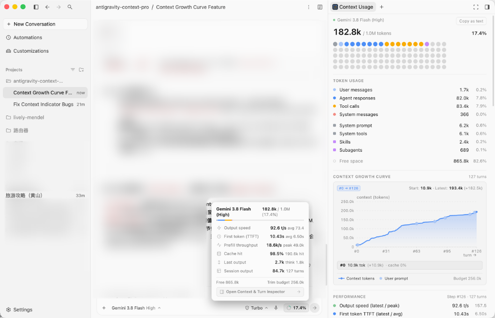

# Antigravity Context Pro (`plugins/desktop-context`)

**English** | [简体中文](README_ZH.md)

A bilingual (`en` / `zh`) context window monitor, prompt cache radar, and generation telemetry inspector for **Antigravity 2.0 Desktop** (macOS, Windows, and Linux). Now built into [`jiangnanquan/agy-desktop-exo`](https://github.com/jiangnanquan/agy-desktop-exo) under `plugins/desktop-context/`.

> [!NOTE]
> **Upstream Attribution**
> Originally forked from [`dimitr-io/antigravity-desktop-context`](https://github.com/dimitr-io/antigravity-desktop-context) (Copyright © 2026 Dimitrios Ioannidis, [MIT License](LICENSE)) and extensively enhanced with live prompt-cache TTL tracking, Cache Bust accounting, panoramic Swarm Radar, Top-Bar telemetry pills, Official Quota Reset Watch, and a zero-CDP native Electron IPC bridge.



---

## Key Features

- **Bilingual UI (`en` / `zh`) with Seamless Auto-Detection**
  - Click the minimalist **`中 / EN`** capsule in the top-right corner of the side panel to switch languages instantly across both the side panel and main window widgets.
  - Supports `"lang": "auto" | "zh" | "en"` persisted in `~/.gemini/context-pro-config.json` (`"auto"` detects `document.documentElement.dataset.agExoLang` from the localization layer, falling back to `navigator.language` or English).
- **Top-Bar Telemetry Pills & Official Quota Reset Watch**
  - Compact live pills in the conversation titlebar showing context usage, 1-second prompt-cache TTL stopwatch, active Swarm/Subagent ratio, and **Reset Watch**.
  - **Official Quota Reset Watch**: Manual-only sync with local disk cache across Gemini (AGY), Codex, and Claude official reset trackers—zero background network polling on startup.
- **Input Box Context Mini-Ring & Live Cache TTL Countdown**
  - Embeds a live SVG context usage ring (`%`) and a zero-overhead local TTL indicator next to the composer send button:
    - `< 3m` (**Warm**): Safe hot-cache reuse window;
    - `3m - 5m` (**Eviction Risk**): Amber warning for potential LRU cache eviction;
    - `>= 5m` (**Cold >5m (re-prefill)**): Hard TTL expired; next turn requires full-price re-prefill.
  - Clicking the ring opens a telemetry popover with **Cache TTL**, **Cache bust**, **Quota & reset**, **Cache hit**, **Output speed (`t/s`)**, **First token (`TTFT`)**, **Prefill throughput**, **Last / Session out**, and one-click shortcuts to **Session** or **Swarm Radar**.
- **Cache Bust Ledger**
  - Detects non-compaction prompt cache rebuilds (when prior context `>= 30k` drops to near-zero cache hits without compaction), summarizing total bust count and wasted uncached input tokens, highlighted directly on the growth curve and turn list.
- **Panoramic Swarm & Subagent Cache Radar**
  - Dual-mode top switcher **`[Session] | [Swarm Radar]`** that automatically resolves any coordinator, native `swarm` worker, or `invoke_subagent` session to its root cluster with deduplication.
  - Displays a 4-card cluster KPI summary (including coordinator pre-dispatch serial steps/duration), TTL legend bar, per-member context watermarks, cache hit rates, and optional configurable model compliance badges.
- **Interactive Context Growth Curve & Per-Turn Call Inspector**
  - Live SVG curve plotting prompt tokens across turns with interactive crosshair inspection and compaction budget line.
  - Expand any turn under **Recent turns** to inspect prompt/cache split, thinking/response latency, snippets, and an exact **Tool Call Token Bill** (`+tok` per tool invocation).
- **Zero-CDP Native Electron IPC Bridge & Persistent macOS Signing**
  - Works seamlessly on Antigravity v2.33.0+ (where remote CDP debugging is disabled by default) via a lightweight ASAR overlay bridge (`scripts/context_bridge_patcher.js`) that coexists non-destructively with localization and `agy-meme` patches.
  - On macOS, automatically uses a trusted local certificate (`AGY_CODESIGN_IDENTITY` or `"Antigravity Local Signer"`) for inside-out code signing when available, gracefully falling back to ad-hoc signing (`--sign -`).

---

## Installation

Requires **Antigravity 2.0 Desktop** and **Python 3** on your `PATH` (`python3`, `python`, or `py`).

### Option A: Unified Installer via `agy-desktop-exo` (Recommended)

This plugin is bundled inside `jiangnanquan/agy-desktop-exo` at `plugins/desktop-context/` and can be installed together with the desktop suite or linked directly into `~/.gemini/config/plugins/desktop-context`.

### Option B: Standalone Plugin Link / Copy & Zero-CDP Bridge

**macOS / Linux**
```bash
# 1. Link or copy into Antigravity plugins directory
mkdir -p ~/.gemini/config/plugins
ln -sfn /path/to/agy-desktop-exo/plugins/desktop-context ~/.gemini/config/plugins/desktop-context

# 2. (Optional, for Antigravity v2.33.0+) Inject the zero-CDP IPC overlay bridge
./plugins/desktop-context/install.sh
```

**Windows (PowerShell)**
```powershell
Copy-Item -Recurse -Force .\plugins\desktop-context "$HOME\.gemini\config\plugins\desktop-context"
node .\plugins\desktop-context\scripts\context_bridge_patcher.js --install
```

Restart Antigravity 2.0, open **Customizations → Installed**, and enable **Context Usage**.

---

## Configuration (`~/.gemini/context-pro-config.json`)

All settings are optional. If `~/.gemini/context-pro-config.json` (or the path specified by `AGY_CONTEXT_PRO_CONFIG`) does not exist, Context Pro runs cleanly with zero preset model restrictions (`audit_rules.enabled = false`) and automatic language detection (`lang = "auto"`).

```json
{
  "lang": "auto",
  "audit_rules": {
    "enabled": false,
    "forbidden_patterns": [],
    "forbidden_label": { "zh": "违禁模型", "en": "Forbidden" },
    "warn_worker_patterns": [],
    "safe_worker_patterns": [],
    "exempt_role_keywords": [],
    "warn_label": { "zh": "越级模型", "en": "Over-tier" },
    "ok_label": { "zh": "合规", "en": "Compliant" }
  }
}
```

### Custom Swarm Model Audit Example

Teams wishing to audit worker model tiers in **Swarm Radar** can set `"enabled": true`:
1. `forbidden_patterns`: Case-insensitive substrings matched against a member's model identifiers; matches are flagged as `violation`.
2. `warn_worker_patterns` / `safe_worker_patterns` / `exempt_role_keywords`: Non-coordinator members matching `warn_worker_patterns` (unless matched by `safe_worker_patterns` or exempted via `exempt_role_keywords` in their name/role) are flagged as `warn`.

---

## CLI Usage & Unit Tests

```bash
# Single-conversation context report
python3 sidecars/context/context_report.py
python3 sidecars/context/context_report.py --json

# Panoramic Swarm & Subagent Radar (supports --lang en|zh and --config)
python3 sidecars/context/swarm_radar.py <conversation_id_or_prefix> --lang en
python3 sidecars/context/swarm_radar.py <conversation_id_or_prefix> --json

# Run full Python + Node test suites
python3 -m unittest discover -s tests -v
node --test tests/*.test.mjs
```

## License

[MIT License](LICENSE) — Original work Copyright © 2026 Dimitrios Ioannidis (`dimitr-io/antigravity-desktop-context`); secondary development and enhancements licensed under MIT.
