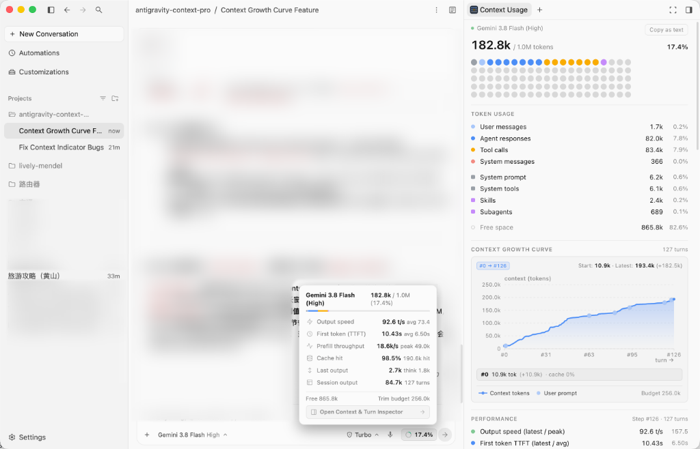

# Antigravity Context Pro (`plugins/desktop-context`)

[English](README.md) | **简体中文**

适用于 **Antigravity 2.0 桌面端**（支持 macOS、Windows、Linux）的中英双语上下文监控、缓存保活雷达与底层性能遥测插件。现已作为官方核心组件内置于 [`jiangnanquan/agy-desktop-exo`](https://github.com/jiangnanquan/agy-desktop-exo) 仓库的 `plugins/desktop-context/` 目录。

> [!NOTE]
> **致谢与来源说明（Upstream Attribution）**
> 本插件基础解析器最初 Fork 自 [`dimitr-io/antigravity-desktop-context`](https://github.com/dimitr-io/antigravity-desktop-context)（原作者 Dimitrios Ioannidis，遵循 [MIT License](LICENSE)），并在此基础上深度扩展了实时缓存 TTL 保活倒计时、Cache Bust 崩塌账本、蜂群全景雷达、顶栏遥测微胶囊、官方配额重置监视面板以及零 CDP 原生 Electron IPC 轻桥接。



---

## 核心功能

- **全链路中英双语（`zh` / `en`）实时切换与自动跟随**
  - 侧边栏右上角刷新按钮旁内置极简克制的 **`中 / EN`** 语言切换胶囊，点击即可毫秒级同步切换侧边栏、主窗口顶栏胶囊、重置监视面板与输入框圆环浮窗语言，并自动持久化至 `~/.gemini/context-pro-config.json`。
  - 默认 `"lang": "auto"` 自动探测宿主界面汉化状态（如 `document.documentElement.dataset.agExoLang`），未安装汉化时根据 `navigator.language` 自动回退简体中文或地道英文。
- **主对话顶栏常驻遥测胶囊与官方重置监视面板**
  - 在主窗口标题栏右侧内嵌精简微胶囊：实时上下文水位 + 秒表级缓存 TTL、关联蜂群活跃比，以及常驻 **重置监视（Reset Watch）** 入口。
  - **官方配额重置监视**：聚合 Gemini (AGY)、Codex、Claude 三大官方配额重置追踪源，支持手工刷新、本地磁盘缓存持久化与原文/译文切换，启动与静默期零外网请求。
- **输入框内嵌上下文小圆环与 3 分钟缓存 TTL 实时倒计时**
  - 在聊天输入框发送按钮旁内嵌动态 SVG 上下文占用小圆环（`%`）与本地零开销 TTL 状态胶囊：
    - `< 3m`（黄金保活期）：翠绿指示，提示热缓存安全复用窗口；
    - `3m - 5m`（LRU 驱逐高危期）：琥珀黄预警，提示随时可能发生缓存驱逐；
    - `>= 5m`（超硬 TTL）：提示 `已冷 >5m (必重灌)` / `Cold >5m (re-prefill)`。
  - 点击小圆环弹出性能概览浮窗，直观展示 **缓存保活（TTL）**、**缓存崩塌（Cache bust）**、**额度与重置**、**缓存命中率**、**输出速度（`t/s`）**、**首字延迟（`TTFT`）**、**预填充吞吐**、**本轮 / 累计输出**，并支持一键打开侧边栏或直达蜂群雷达。
- **缓存崩塌账本（Cache Bust Ledger）**
  - 自动识别非压缩态下的“缓存归零/断崖全价重灌”事件（前轮上下文 `>= 30k` 且未发生压缩时出现全价重灌），统计崩塌总次数与累计白烧输入 Token，并在增长曲线与单轮列表中醒目标注。
- **蜂群与子代理全景缓存雷达（Swarm & Subagent Cache Radar）**
  - 侧边栏顶部提供 **`[单会话详情] | [蜂群雷达]`** 双模切换栏，支持从主控、原生 `swarm` 工兵或 `invoke_subagent` 子代理双向反查锁定根集群并自动去重。
  - 呈现**蜂群总览 4 宫格**（含主控建群前串行步数/耗时稽核、全群综合缓存命中率、缓存崩塌总账、活跃/总成员统计）、**缓存 TTL 图例色带**与成员上下文水位明细，并支持按需开启自定义模型合规审计徽章。
- **交互式上下文增长曲线与逐轮调用审查（DeepSeek Harness 风格）**
  - 原生 SVG 绘制会话上下文随轮次增长曲线与自动压缩预算线，支持悬浮准星探针与点击联动展开对应轮次。
  - 展开任意轮次即可审查输入/缓存拆分、思考链/正文耗时、内容摘要以及精确到每个工具的 **工具调用 Token 账单（`+tok`）**。
- **零 CDP 原生 Electron IPC 桥接与 macOS 固定证书持久签名**
  - 通过 `scripts/context_bridge_patcher.js` 提供极薄 ASAR 叠加桥接层，完美适配默认关闭 CDP 端口的 Antigravity v2.33.0+，与界面汉化及 `agy-meme` 表情包无损共存、独立装卸。
  - 在 macOS 下优先检测登录钥匙串中受信任的本地代码签名证书（`AGY_CODESIGN_IDENTITY` 或默认 `"Antigravity Local Signer"`）执行 Inside-Out 持久签名，未配置证书时自动平滑回退 `--sign -`（`adhoc` 签名）。

---

## 安装说明

依赖环境：**Antigravity 2.0 桌面端** 及系统 `PATH` 中可用的 **Python 3**（`python3`、`python` 或 `py`）。

### 方式一：通过 `agy-desktop-exo` 统一安装（推荐）

本插件现已内置于 `jiangnanquan/agy-desktop-exo` 的 `plugins/desktop-context/` 目录，可通过外层统一安装器一键部署，或直接软链接至插件目录。

### 方式二：独立挂载插件与注入零 CDP 桥接层

**macOS / Linux**
```bash
# 1. 软链接或拷贝到 Antigravity 插件目录
mkdir -p ~/.gemini/config/plugins
ln -sfn /path/to/agy-desktop-exo/plugins/desktop-context ~/.gemini/config/plugins/desktop-context

# 2. （适配 Antigravity v2.33.0+）叠加注入零 CDP 原生 IPC 桥接层
./plugins/desktop-context/install.sh
```

**Windows (PowerShell)**
```powershell
Copy-Item -Recurse -Force .\plugins\desktop-context "$HOME\.gemini\config\plugins\desktop-context"
node .\plugins\desktop-context\scripts\context_bridge_patcher.js --install
```

重启 Antigravity 2.0 后，在 **Customizations → Installed**（自定义 → 已安装）中开启 **Context Usage** 即可使用。

---

## 配置文件契约（`~/.gemini/context-pro-config.json`）

所有配置项均为可选（亦可通过环境变量 `AGY_CONTEXT_PRO_CONFIG` 指定路径以便测试隔离）。当文件不存在或字段缺失时，默认以零预设拦截模式运行（`audit_rules.enabled = false`，蜂群成员列表仅展示纯净模型名称）。

```json
{
  "lang": "auto",
  "audit_rules": {
    "enabled": false,
    "forbidden_patterns": [],
    "forbidden_label": { "zh": "违禁模型", "en": "Forbidden" },
    "warn_worker_patterns": [],
    "safe_worker_patterns": [],
    "exempt_role_keywords": [],
    "warn_label": { "zh": "越级模型", "en": "Over-tier" },
    "ok_label": { "zh": "合规", "en": "Compliant" }
  }
}
```

### 开启自定义蜂群模型合规审计

如需在团队协作中对蜂群工兵的模型档位进行自动稽核，可将 `audit_rules.enabled` 设为 `true` 并按需填写匹配规则（大小写不敏感子串匹配）：
1. `forbidden_patterns`：命中任意规则的成员标记为 `violation`（红色徽章，展示对应语言的 `forbidden_label`）；
2. `warn_worker_patterns` / `safe_worker_patterns` / `exempt_role_keywords`：非 `coordinator` 成员若未命中 `safe_worker_patterns` 且命中 `warn_worker_patterns`，同时其名称与角色未命中 `exempt_role_keywords`，则标记为 `warn`（琥珀色徽章，展示对应语言的 `warn_label`）；其余成员标记为 `ok`。

---

## 命令行调用与单元测试

```bash
# 查看单会话上下文账单报告
python3 sidecars/context/context_report.py
python3 sidecars/context/context_report.py --json

# 查看蜂群与子代理全景雷达（支持 --lang zh|en 与 --config）
python3 sidecars/context/swarm_radar.py <conversation_id_or_prefix> --lang zh
python3 sidecars/context/swarm_radar.py <conversation_id_or_prefix> --json

# 运行完整 Python 与 Node 单元测试套件
python3 -m unittest discover -s tests -v
node --test tests/*.test.mjs
```

## 开源协议

[MIT License](LICENSE) — 原版代码版权归 Dimitrios Ioannidis (`dimitr-io/antigravity-desktop-context`) 所有；二次开发与增强部分同样以 MIT 协议开源。
